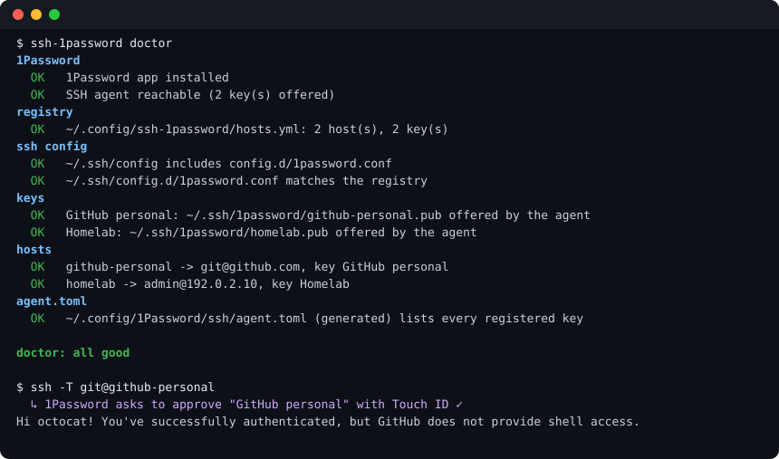

For years my `~/.ssh` looked like everyone's: an `id_ed25519` that GitHub, the servers of every
project I manage and the homelab all accepted, plus a couple of older keys I was afraid to delete. It worked, and it was a
liability. That file opens every door, for anything that can read it, without asking me.

This post is about moving those keys into 1Password, the problems that shows up once you have more
than a couple of keys, and the small tool I wrote to make the setup boring and portable:
[ssh-1password](https://github.com/farming-apps/ssh-1password).

## What's wrong with a key file

A private key on disk is a bearer credential. Whoever has the bytes has the access:

- **Any process running as you can copy it.** A malicious npm/pip package, a compromised editor
  extension, a script you pasted from a README. A passphrase helps until the key is unlocked in an
  agent for the rest of the day.
- **It ends up in places you forget.** Backups, disk images, the old laptop in a drawer.
- **One key usually opens everything.** Rotating it means finding every server and forge that
  trusts it.

## The 1Password SSH agent fixes the storage part

1Password ships an SSH agent. You create (or import) keys in your vault, turn on
**Settings → Developer → Use the SSH agent**, point ssh at its socket, and from then on:

- the private key **never touches the disk**;
- every use asks for **Touch ID** (or your system unlock on Linux);
- every use shows up in the item's **Activity** tab.

If an approval prompt appears that you did not trigger, that is your signal that something on the
machine is trying to use your keys. Deny it.

## …and creates a new problem once you have several keys

By default the agent offers ssh **every key it holds**, one after another. Servers cap failed
attempts (OpenSSH's `MaxAuthTries` is 6), so with five or six keys you start seeing:

```text
Received disconnect from 192.0.2.10 port 22:2: Too many authentication failures
```

And on GitHub the *first* key that matches an account wins, so with separate accounts for different
projects or clients you push as the wrong one.

The standard fix is to give each host only its key: an `IdentityFile` pointing at the **public**
key, plus `IdentitiesOnly yes`. ssh then asks the agent for exactly that key, and the private half
stays in 1Password:

```text
Host github-acme
    HostName github.com
    User git
    IdentityFile ~/.ssh/1password/github-acme.pub
    IdentitiesOnly yes
```

Doing that by hand means exporting each `.pub`, writing a `Host` block per alias, keeping
1Password's `agent.toml` in sync, and remembering all of it on the next machine. That's the part I
automated.

## One registry, generated config

ssh-1password is a single Python script (standard library only, macOS and Linux, no `op` CLI). You
describe your hosts in one file:

```yaml
# ~/.config/ssh-1password/hosts.yml
github-personal:
  hostname: github.com
  user: git
  key: GitHub personal          # title of the SSH key item in 1Password
github-acme:
  hostname: github.com
  user: git
  key: GitHub Acme
  vault: Acme                   # only for keys outside your default vaults
  email: me@acme.example        # git identity for repos cloned through this alias
gitlab-orbit:                   # another project: its own key and identity
  hostname: gitlab.com
  user: git
  key: GitLab Orbit
  email: me@orbit.example
homelab:
  hostname: 192.0.2.10
  user: admin
  key: Homelab
```

Then:

```sh
ssh-1password sync      # fetches the .pub files from the agent, writes the config
ssh-1password doctor    # checks that it all lines up
ssh -T git@github-acme  # 1Password asks once; GitHub says "Hi <user>!"
```

`sync` writes:

- `~/.ssh/1password/<key>.pub`: public keys read from the agent (`ssh-add -L`), never a private key;
- `~/.ssh/config.d/1password.conf`: one `Host` block per alias, plus `IdentityAgent`,
  `ForwardAgent no` and `AddKeysToAgent no` for everything;
- 1Password's `agent.toml`, listing only the registered keys (only if the file is missing or was
  generated by the tool; a file you wrote yourself is left alone);
- one `Include` line appended **once, at the end** of your `~/.ssh/config`, with a backup.

Because the Include is last and ssh uses the first value it finds, any `Host` block you write above
it wins. A client bastion that imposes its own key file keeps working.

It's idempotent, and `--dry-run` shows everything before writing.

### One key per trust domain, not per host

A key per host sounds safest, but you end up with forty keys nobody rotates. A single key for
everything is the problem we started with. The middle ground: **one key per trust domain**, which in
practice means one per project or client, plus one for the homelab. Several hosts share a key; a compromise of one domain
doesn't open the others.

### Git identity per alias, and commit signing

Add `email:` to a host and every repository cloned through that alias commits with that identity,
without per-repo `git config`. Under the hood that's git's
`includeIf "hasconfig:remote.*.url:..."` (git 2.36+), pointing at a small generated file per alias.

Add `sign: manual` or `sign: always` and the **same 1Password key signs your commits** through SSH
signatures, which GitHub and GitLab show as "Verified". No GPG, no key exported to `~/.gnupg`.

### `doctor` tells you what drifted

Configs rot: someone adds a `Host *` with an extra `IdentityFile`, a key gets renamed in 1Password,
the agent toggle gets turned off after an update. `doctor` checks the agent socket, that each
registered key is offered, resolves every alias with `ssh -G` to make sure nothing above the Include
overrides it, and creates a throwaway repo to verify which identity git would actually use.



## The part I didn't expect: portability

Once the keys live in the vault, the only thing that describes my SSH setup is `hosts.yml`, and it
holds **no secrets**: aliases, hostnames, users and key titles. Setting up a new machine became:

1. Install 1Password, sign in, enable the SSH agent.
2. Install the tool:

   ```sh
   curl -fLO https://github.com/farming-apps/ssh-1password/releases/latest/download/install.sh
   sh install.sh
   ```

3. Copy `hosts.yml` from my private dotfiles (or point `SSH_1P_HOSTS` at it).
4. `ssh-1password sync`.

Same aliases, same keys, same git identities, on macOS or Linux. No copying `~/.ssh` over a USB
stick, no generating keys and uploading them to fifteen servers again.

And leaving a machine is just as boring: there is no private key to wipe. What `sync` wrote is
public by nature. Sign out of 1Password and that machine can't use the keys anymore.

(Hostnames are still endpoints you may not want public, so keep the registry in a *private* dotfiles
repo or a 1Password Secure Note.)

## Where it doesn't fit

- **Unattended jobs.** cron, systemd timers and CI runners have nobody to press Touch ID. Give them
  a dedicated file key restricted in `authorized_keys` (`command=`, `no-pty`,
  `no-port-forwarding`) and an `IdentityAgent none` entry above the Include.
- **Agent forwarding.** It's off by default. Use `ProxyJump` for hops instead of exposing your agent
  to the intermediate host.
- **AI agents and scripts on your desktop.** They can use the agent while 1Password is unlocked, and
  you'll get the prompt. If a command just hangs, look for "SSH request waiting" in the 1Password
  menu bar icon.

## Try it

```sh
curl -fLO https://github.com/farming-apps/ssh-1password/releases/latest/download/install.sh
less install.sh   # it verifies the release checksum and only links ~/.local/bin/ssh-1password
sh install.sh
```

- Repo: [github.com/farming-apps/ssh-1password](https://github.com/farming-apps/ssh-1password)
- Why this approach, in one page: [farming-apps.github.io/ssh-1password](https://farming-apps.github.io/ssh-1password/)

It's MIT, a single script, and issues and PRs are welcome. If you're still carrying an
`id_ed25519` from three laptops ago, this is a good weekend to retire it.
